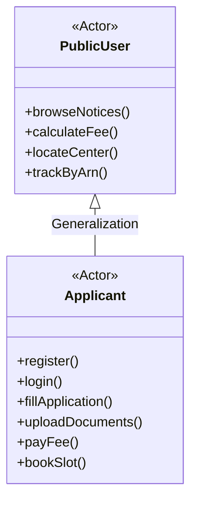
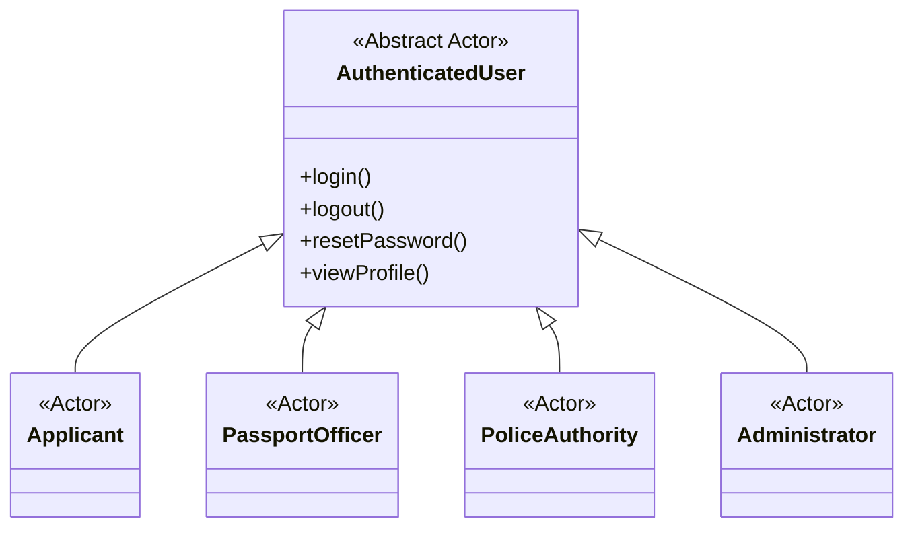

# Actor Identification and Role Analysis

## 1. Introduction and Architectural Context

In the **Passport Automation System (PAS)**, an actor represents an external entity (a human user, a specialized operational role, or an autonomous external service) that interacts with the system boundary to achieve defined business outcomes. 

The application architecture enforces strict **Role-Based Access Control (RBAC)** implemented via cryptographic JSON Web Tokens (`lib/auth.ts`) and verified in Next.js Server Components, Server Actions, and API Route Handlers. User entities (`User` model in `prisma/schema.prisma`) are linked in a 1-to-1 composition with specialized profile extensions (`Applicant`, `PassportOfficer`, `Police`, or `Admin`).

```
                +------------------------------------+
                |       Passport Automation System    |
                +------------------------------------+
                                  |
         +------------------------+------------------------+
         |                        |                        |
[Public Visitor]          [Citizen / Applicant]    [Passport Officer]
(Unauthenticated)             (Role: APPLICANT)        (Role: OFFICER)
         |                        |                        |
         +------------------------+------------------------+
                                  |
         +------------------------+------------------------+
         |                                                 |
  [Police Authority]                            [System Administrator]
   (Role: POLICE)                                   (Role: ADMIN)
```

---

## 2. Primary Actors

### 2.1 Actor 1: Citizen / Applicant

- **Actor Name:** Citizen / Applicant (`Applicant`)
- **Actor Type:** Primary Human Actor (Authenticated)
- **Database Model Mapping:** `model User` (where `role = "APPLICANT"`) $\leftrightarrow$ `model Applicant`
- **Description:** A registered citizen of India seeking statutory passport issuance, re-issue, Tatkaal expedition, or Police Clearance Certificates (PCC) under the Passports Act, 1967.
- **Responsibilities:**
  1. Register an account and authenticate using email and password credentials with Captcha protection.
  2. Initiate, edit, save draft, and finalize multi-step passport applications.
  3. Declare biographical particulars, family linkages, residential addresses, and criminal/statutory eligibility declarations.
  4. Upload scanned KYC proof documents (Proof of Address, Proof of Date of Birth, Non-ECR qualification certificates).
  5. Settle statutory application fees via simulated payment gateway channels (UPI, Net Banking, Credit/Debit card).
  6. Reserve, view, reschedule, or cancel Passport Seva Kendra (PSK) appointment slots.
  7. Undergo simulated PSK physical counter transitions (Counters A, B, and C).
  8. Track application lifecycle stages and respond to officer-issued clarification requests.
  9. Lodge citizen grievance tickets and track resolution feedback.
- **System Interaction & Interfaces:**
  - **Client Pages:** `/register`, `/login`, `/applicant/dashboard`, `/applicant/application`, `/applicant/documents`, `/applicant/payment`, `/applicant/appointment`, `/applicant/psk-simulation`, `/applicant/status`, `/grievance`.
  - **API Route Handlers:** `/api/applicant/application`, `/api/applicant/documents`, `/api/applicant/payment`, `/api/applicant/appointment`, `/api/applicant/appointment/reschedule`, `/api/applicant/status`, `/api/grievance`.
  - **Authentication Requirement:** Active session token (`pas_session` cookie) with role `APPLICANT`.
- **Main Use Cases:**
  - `UC-05: Register Citizen Account`
  - `UC-06: User Login & Session Auth`
  - `UC-07: Reset Password via Email`
  - `UC-08: Apply for Passport (Fresh/Reissue)`
  - `UC-09: Provide Minor Consent Declaration`
  - `UC-10: Upload Identity & Address Proofs`
  - `UC-11: Pay Application Fee Online`
  - `UC-12: Generate Digital Payment Receipt`
  - `UC-13: Book PSK Appointment Slot`
  - `UC-14: Reschedule PSK Appointment`
  - `UC-15: Simulate PSK Counter Flow (A/B/C)`
  - `UC-16: Submit Citizen Grievance`
  - `UC-17: View Notifications & Alerts`
  - `UC-18: Respond to Clarification Request`

---

### 2.2 Actor 2: Passport Officer

- **Actor Name:** Passport Officer (`PassportOfficer`)
- **Actor Type:** Primary Human Actor (Internal Authority)
- **Database Model Mapping:** `model User` (where `role = "OFFICER"`) $\leftrightarrow$ `model PassportOfficer`
- **Description:** An authorized official of the Regional Passport Office (RPO) / Passport Seva Kendra (PSK) tasked with scrutinizing citizen dossiers, verifying physical original certificates against digital scans, conducting Granting Officer reviews under Section 6 of the Passports Act 1967, and managing booklet printing and dispatch.
- **Responsibilities:**
  1. Authenticate with official credentials and view assigned application queues.
  2. Inspect uploaded digital proofs alongside physical original certificates (Counter B scrutiny).
  3. Mark individual documents as `VERIFIED` or flag them as `CORRECTION_REQUIRED`.
  4. Raise formal clarification notices (`CLARIFICATION_REQUIRED`) specifying missing declarations or defects.
  5. Transmit verified dossiers to jurisdictional Police Stations for field enquiries (`POLICE_VERIFICATION_PENDING`).
  6. Evaluate completed Police Verification Reports (PVR) and statutory eligibility criteria (Counter C Granting).
  7. Grant final statutory approval (`APPROVED`) and generate unique passport booklet numbers (`PXXXXXXX`).
  8. Hand over approved applications to secure booklet personalization queues (`PRINTING`).
  9. Record India Post Speed Post consignment tracking numbers and dispatch passports (`DISPATCHED`).
  10. Issue statutory refusal / rejection orders (`REJECTED`) under Section 6 with documented reasons.
- **System Interaction & Interfaces:**
  - **Client Pages:** `/officer/dashboard`, `/login`.
  - **API Route Handlers:** `/api/officer/applications`, `/api/officer/action`, `/api/documents/[docId]/signed-url`.
  - **Authentication Requirement:** Active session token with role `OFFICER` and valid `PassportOfficer` profile link.
- **Main Use Cases:**
  - `UC-19: View Assigned Officer Scrutiny Queue`
  - `UC-20: Scrutinize Application Dossier & Biometrics`
  - `UC-21: Verify Uploaded Document Proofs`
  - `UC-22: Request Applicant Clarification`
  - `UC-23: Initiate Police Verification Routing`
  - `UC-24: Review Police Verification Report (PVR)`
  - `UC-25: Grant Application Approval`
  - `UC-26: Issue Passport Booklet & Number`
  - `UC-27: Dispatch Passport via India Post`
  - `UC-28: Reject Application under Passports Act Sec 6`

---

### 2.3 Actor 3: Police Authority

- **Actor Name:** Police Authority (`Police`)
- **Actor Type:** Primary Human Actor (Verification Agency)
- **Database Model Mapping:** `model User` (where `role = "POLICE"`) $\leftrightarrow$ `model Police`
- **Description:** The jurisdictional Police Station In-Charge (Station House Officer) or assigned Field Verification Officer (Constable/Sub-Inspector) responsible for conducting physical residential verification, local reference inquiries, and criminal background checks.
- **Responsibilities:**
  1. Authenticate into the dedicated Police Station Portal and view pending verification dossiers.
  2. Examine applicant identity, claimed residential address, and declared duration of continuous stay.
  3. Conduct physical site visits to the applicant's present address and record neighbor/witness statements.
  4. Cross-check applicant particulars against local police station crime records and the CCTNS database.
  5. Formulate and submit an official electronic Police Verification Report (`PoliceReport`):
     - `CLEARED`: Address verified, citizenship confirmed, zero criminal record, applicant met in person.
     - `ADVERSE`: Disputed residence, non-citizen status, or pending criminal FIRs/proceedings.
     - `CLARIFICATION_REQUIRED`: Applicant untraceable or local address temporarily locked.
  6. Digitally submit the signed PVR to transition the application state to `POLICE_VERIFICATION_COMPLETED`.
- **System Interaction & Interfaces:**
  - **Client Pages:** `/police/dashboard`, `/login`.
  - **API Route Handlers:** `/api/police/enquiries`, `/api/police/report`.
  - **Authentication Requirement:** Active session token with role `POLICE` and linked `Police` station record.
- **Main Use Cases:**
  - `UC-29: View Jurisdictional Police Enquiry Queue`
  - `UC-30: Assign Enquiry to Field Verification Officer`
  - `UC-31: Conduct Address & Criminal Verification`
  - `UC-32: Search CCTNS & Local Crime Records`
  - `UC-33: Submit Electronic Police Verification Report (PVR)`

---

### 2.4 Actor 4: System Administrator

- **Actor Name:** System Administrator (`Admin`)
- **Actor Type:** Primary Human Actor (System Governance)
- **Database Model Mapping:** `model User` (where `role = "ADMIN"`) $\leftrightarrow$ `model Admin`
- **Description:** A privileged systems administrator responsible for maintaining master records, configuring statutory fee schedules under Gazette notifications, managing PSK centres, publishing public advisories, managing user access roles, and inspecting security audit logs.
- **Responsibilities:**
  1. Access the administrative console via dedicated authentication channels.
  2. Monitor system KPIs: application throughput, verification bottlenecks, fee collections, and active grievances.
  3. Manage user accounts: modify access roles (`APPLICANT`, `OFFICER`, `POLICE`, `ADMIN`), unlock security-locked accounts, and deactivate malicious sessions.
  4. Maintain the Passport Services Catalog (`PassportService` model): add/edit service codes, descriptions, and eligibility criteria.
  5. Configure Regional Passport Offices (RPO) and Passport Seva Kendras (`PassportCenter` model), including daily booking capacity and operational hours.
  6. Update statutory Fee Schedules (`FeeSchedule` model) in conformance with Gazette notifications (e.g., GSR 516(E)).
  7. Publish, pin, edit, and archive Public Notices and Gazette Circulars (`Notice` model) with CSV/JSON batch import.
  8. Triage citizen grievance tickets (`Grievance` model), assign nodal investigators, and enter formal resolution findings.
  9. Audit system events, inspect `LoginHistory` records, revoke compromised user sessions, and review `AuditLog` entries.
- **System Interaction & Interfaces:**
  - **Client Pages:** `/admin/login`, `/admin/dashboard`, `/admin/applications`, `/admin/applications/[id]`, `/admin/users`, `/admin/users/[id]`, `/admin/roles`, `/admin/administrators`, `/admin/invitations`, `/admin/centres`, `/admin/fees`, `/admin/notices`, `/admin/grievances`, `/admin/audit-logs`, `/admin/security`, `/admin/security/login-history`, `/admin/security/sessions`, `/admin/analytics`, `/admin/system`.
  - **API Route Handlers:** `/api/admin/*` (26 dedicated RESTful route handlers).
  - **Authentication Requirement:** Active session token with role `ADMIN` and valid `Admin` record.
- **Main Use Cases:**
  - `UC-34: Admin Login & Session Initialization`
  - `UC-35: View Executive Analytics & System Health`
  - `UC-36: Inspect & Override Application Dossiers`
  - `UC-37: Manage User Accounts & Security Locks`
  - `UC-38: Modify User Access Roles (RBAC)`
  - `UC-39: Invite Administrative Staff via Secure Token`
  - `UC-40: Maintain Passport Services Directory`
  - `UC-41: Configure PSK & POPSK Regional Centres`
  - `UC-42: Manage Statutory Fee Schedules (GSR 516E)`
  - `UC-43: Publish Official Notices & Gazette Circulars`
  - `UC-44: Batch Import Historical Notices (CSV/JSON)`
  - `UC-45: Triage & Resolve Citizen Grievance Tickets`
  - `UC-46: Monitor Security Audit Logs & Revoke Sessions`

---

### 2.5 Actor 5: Public User (Visitor)

- **Actor Name:** Public User / Visitor (`PublicUser`)
- **Actor Type:** Primary Human Actor (Unauthenticated External Citizen)
- **Database Model Mapping:** No persistent `User` record required for public endpoints.
- **Description:** Any citizen or visitor who accesses the public web portal without logging in to discover service rules, calculate statutory fees, locate centres, verify document checklists, or track an active application reference number (ARN).
- **Responsibilities:**
  1. Browse official announcements, gazette circulars, and passport mela alerts.
  2. Search and filter public notices by category, publication year, and affected region.
  3. View the catalog of available passport services, eligibility rules, and validity norms.
  4. Compute exact statutory fees using the interactive Fee Calculator based on age, service scheme, and booklet size.
  5. Locate jurisdictional PSK, POPSK, and RPO centres with addresses and operating hours.
  6. Use the Document Advisor wizard to determine required KYC proofs.
  7. Track live passport application progress by entering an ARN, Date of Birth, and solving a Captcha challenge.
  8. Lodge public grievance tickets and track grievance redressal by Ticket ID.
- **System Interaction & Interfaces:**
  - **Client Pages:** `/`, `/services`, `/news`, `/news/[slug]`, `/fee-calculator`, `/locate-centre`, `/document-advisor`, `/track`, `/grievance`, `/faq`, `/help`, `/privacy`, `/terms`.
  - **API Route Handlers:** `/api/services`, `/api/news`, `/api/news/[slug]`, `/api/fees/calculate`, `/api/centres`, `/api/track`, `/api/grievance`.
  - **Authentication Requirement:** None (Unauthenticated public access).
- **Main Use Cases:**
  - `UC-01: Browse Services Directory`
  - `UC-02: View Gazette Notices & Public Advisories`
  - `UC-03: Calculate Statutory Fee (GSR 516E)`
  - `UC-04: Locate PSK / POPSK Centres`
  - `UC-05: Query Document Advisor Checklist`
  - `UC-06: Track Application by ARN & DOB (Public Tracking)`
  - `UC-07: Lodge Public Grievance Ticket`

---

## 3. Supporting and External Actors

In addition to human actors, the Passport Automation System interfaces with simulated external services:

| Actor Name | Actor Type | Integration Point & Purpose | Supported Use Cases |
| :--- | :--- | :--- | :--- |
| **Payment Gateway** (`PaymentGateway`) | Supporting System (External Cloud) | Simulates electronic fee collection via SBI ePay / Bharatkosh / UPI / NetBanking. Returns digitally signed transaction acknowledgments (`transactionId`). | `UC-11: Pay Application Fee Online` |
| **India Post Speed Post** (`IndiaPostLogistics`) | Supporting System (Logistics) | Simulates consignment booking, barcode generation (`INxxxxxxxxxxTRK`), transit tracking, and final physical delivery to citizen address. | `UC-27: Dispatch Passport`, `UC-06: Track Application` |
| **CCTNS Database** (`CCTNSDatabase`) | Supporting System (Law Enforcement) | Simulates the national Crime and Criminal Tracking Network & Systems database searched by police officers to detect pending FIRs or warrants. | `UC-32: Search CCTNS & Local Crime Records` |
| **DigiLocker Service** (`DigiLockerAPI`) | Supporting System (Government KYC) | Simulates automated digital retrieval of Aadhaar and 10th Class certificates directly into application dossiers. | `UC-10: Upload Identity & Address Proofs` |
| **Notification Gateway** (`EmailSMSGateway`) | Supporting System (Messaging) | Handles transactional dispatch of registration confirmations, payment receipts, appointment slips, and dispatch alerts via SMTP. | `UC-05, UC-11, UC-13, UC-27` |

---

## 4. Generalization and Actor Hierarchies

In UML modeling, `Applicant` is a specialization of `Public User`. An Applicant possesses all capabilities of a Public User (e.g., fee computation, notice discovery, public tracking) and additionally possesses private authenticated privileges (dossier creation, document upload, appointment scheduling, payment):



Similarly, `Passport Officer`, `Police Authority`, and `Administrator` all inherit the base authentication and session capabilities of the abstract `Authenticated User`:


